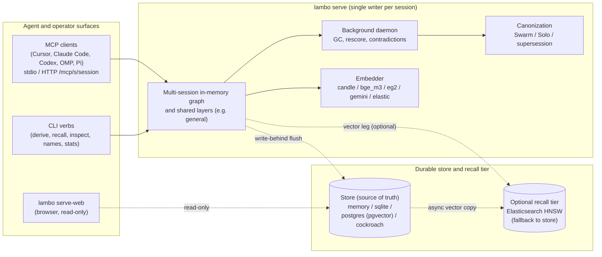

# Lambo

Shared, self-consolidating graph memory for coding agents and multi-agent AI operations.
Lambo stores what your agents learn across Cursor, Claude Code, Codex, OMP, Pi, and custom
MCP clients, recalls it by meaning and dependency structure, and promotes concepts to
canonical facts when they earn it from structural evidence — never when an agent declares
them important.

### [Read the documentation at nrynss.github.io/lambo](https://nrynss.github.io/lambo)

[Quickstart](https://nrynss.github.io/lambo/quickstart/) ·
[Demo](https://nrynss.github.io/lambo/demo/) ·
[Installation](https://nrynss.github.io/lambo/installation/) ·
[MCP tools](https://nrynss.github.io/lambo/mcp/) ·
[Command line](https://nrynss.github.io/lambo/cli/) ·
[Configuration](https://nrynss.github.io/lambo/config/) ·
[Canonization](https://nrynss.github.io/lambo/canonization/) ·
[Migration](https://nrynss.github.io/lambo/migration/) ·
[Library API](https://nrynss.github.io/lambo/api/) ·
[Evidence](https://nrynss.github.io/lambo/evidence/)

## Why Lambo

Coding agents and autonomous workers generate observations across dozens of short-lived
context windows. Flat notes and vector RAG accumulate near-duplicate paragraphs and cannot
tell which decisions are load-bearing when another agent comes back to change something.

Lambo keeps a typed bipartite graph of **interactions** and **concepts** (`Entity`,
`Logic`, `Constraint`, `Resource`, `Observation`) joined by structural edges (`Dependency`,
`Hierarchical`, `Causal`, `Semantic`, `CoOccurrence`, `Contradicts`).

- **Multi-harness, multi-model.** One `lambo serve` process owns a session (or a set of
  project sessions plus shared layers such as `general`) as its single writer. Multiple
  independent clients connect over streamable HTTP (`/mcp/s/<session>`) or stdio (with
  automatic local Unix-socket forwarding when a second stdio client targets a held session).
- **Evidence-earned promotion.** A background daemon scores concepts from graph structure
  alone and promotes them across audited gates (`Candidate` → `Venerable` → `Canonical`).
  Blast radius and load-bearing warnings travel in recall blocks so agents see what rests on
  a decision or component before breaking it.
- **Contradictions, staleness, and durable names.** Agents can refute outdated beliefs with
  `against`, audit downstream dependents via `lambo_stale`, receive suspected-supersession
  and replacement-candidate alerts, bind durable normalized concept names that survive
  restarts, and isolate identical file paths across repositories with `repo_scope`.
- **Multimodal and calibrated retrieval.** Supports text and image memory (`lambo_derive_image`
  and image/vector recall via EmbeddingGemma 2 or client vectors), per-contract recall
  calibration across embedding models, a startup embedder canary, per-recall `top_legs` and
  provisional `confidence`, and optional reciprocal rank fusion or redundancy-aware selection.
- **Verified on real multi-session dogfood stores.** Release re-pin gates, cross-store
  parity matrices, calibration runs, and negative research results live in
  [`evidence/`](https://github.com/nrynss/lambo/tree/main/evidence) and
  [`research/`](https://github.com/nrynss/lambo/tree/main/research).

## Install and run

Prebuilt binaries are published for Linux (`x86_64`, `arm64`) and macOS (`arm64`) carrying
the full `ship` adapter set (`memory`, `sqlite`, `postgres`, `cockroach`, `fixture`,
`bge_m3`/`openai`, `gemini`, `embeddinggemma2`, `elastic`, and the optional `recall-elastic`
tier). Picking backends is a config change in `lambo.toml`, not a different binary.

### Zero-sidecar quickstart on Apple Silicon

On Apple Silicon, `LAMBO_FLAVOR=metal` installs the Metal build with the in-process Candle
BGE-M3 embedder compiled in — no `llama-server`, no external database, and no sidecar:

```bash
curl -fsSL https://github.com/nrynss/lambo/releases/latest/download/install.sh | LAMBO_FLAVOR=metal sh
```

Write a `lambo.toml` for local SQLite + Metal Candle BGE-M3 with single-writer `Solo`
promotion:

```toml
promotion_policy = "Solo"

[store]
kind = "sqlite"
path = "./lambo.db"

[embedder]
kind = "candle"
device = "metal"
dim = 1024
```

Provision the schema once and start serving:

```bash
lambo --config lambo.toml provision
lambo --config lambo.toml serve --session work --agent claude-opus --transport http
```

On first use, Candle fetches BGE-M3 weights (~1.1 GB) once from Hugging Face into the local
cache (~60 s first fetch, ~1.5–3 s warm start thereafter).

### Standard install (Linux and macOS)

```bash
curl -fsSL https://github.com/nrynss/lambo/releases/latest/download/install.sh | sh
```

Both commands verify SHA-256 checksums and install to `~/.local/bin`. See
[Installation](https://nrynss.github.io/lambo/installation/) for version pinning, MCP client
registration (`mcpServers` for Cursor, Claude Code, Codex, OMP, Pi), building from source
(including `--features ship,embed-candle-cuda` for NVIDIA GPUs), and Windows status
([#39](https://github.com/nrynss/lambo/issues/39)). `cargo install lambo` builds the leaner
default feature set (`store-memory`, `embed-bge`, `embed-fixture`); build from source with
`--features ship` for the full adapter set.

### Watch it work with zero config

`lambo demo` runs two agents building one REST API against an in-memory store in seconds —
no config file, no database, and no model download:

```bash
lambo demo
```

`user schema` earns `Canonical` status through the real canonization engine, and the second
agent's recall warns that it is a load-bearing pillar (blast radius 15) modified seconds
earlier. The rendered outcome is deterministic and tested byte-identical across runs. See
the [Demo guide](https://nrynss.github.io/lambo/demo/) and
[`docs/demo.md`](https://github.com/nrynss/lambo/blob/main/docs/demo.md).

## Deployment model and MCP surface

One `lambo serve` process owns each active session as its **single writer** under a
fenced lease. Agents connect over **MCP** (stdio or streamable HTTP) and share the
process's in-memory graph; mutations batch asynchronously via a write-behind log to the
durable store, with durable write intents replayed across clean restarts and embedder
outages.

- **One HTTP server, many projects and layers.** `[serve]` lets a single `lambo serve --transport http`
  pin multiple sessions at `/mcp/s/<session>`, layer shared sessions such as `general` under
  every project's recall (`[serve] layers = ["general"]`), and scope bearer tokens per
  credential (`[[serve.credential]]`).
- **Directory-aware stdio and local forwarding.** `[[serve.projects]]` maps working
  directories (including worktree globs) to session names automatically. Starting a second
  stdio `lambo serve` against a held session on the same machine transparently forwards over
  a private per-user Unix socket instead of failing on lease contention.
- **Read-only readers never write.** Any number of CLI readers (`lambo recall`,
  `lambo inspect`, `lambo stats --store`) or browser windows (`lambo serve-web`) read
  directly from the durable store without touching the writer lease.

Lambo exposes **9 MCP tools**: **8 always-on tools** plus `lambo_derive_image`, which a
server lists automatically when its embedder supports images or when
`[embedder] accept_client_vectors = true` is set:

| Tool | Purpose |
|---|---|
| `lambo_recall` | Hybrid semantic + keyword + graph-traversal recall with blast-radius, conflict, contradiction, stale-citation, and suspected-supersession warnings, plus `top_legs` and provisional `confidence`. |
| `lambo_derive` | Store atomic facts (`entity`, `logic`, `constraint`, `resource`, `observation`) with optional durable `name`, `depends_on` citations, `against` contradictions, `parent_of` hierarchy, `repo_scope`, `scope`, and `event_time`. Returns a background write receipt. |
| `lambo_derive_image` | Store an image concept (caption + inline PNG/JPEG/WebP or client-computed vector) in the same embedding space so text or image recalls find it. Listed when image embedding or client vectors are enabled. |
| `lambo_record_action` | Record completed work with `produces`, `modifies`, `depends_on`, and `against` edges (acyclic structural graphs). |
| `lambo_inspect` | Inspect a concept by durable name, UUID, short ID, or text: type, resolution kind, blast radius, dependents, typed edges, contradictions, and live next-hop canonization gates. |
| `lambo_reserve` | Acquire or release an advisory soft lock on a node before editing it. |
| `lambo_saints` | List concepts that have earned `Canonical` status in the session or a shared layer. |
| `lambo_stale` | Paginate direct dependencies currently resting on contradicted concepts. |
| `lambo_stats` | Inspect writer health, flush lag, queue telemetry, GC stats, embedding contract, missing-vector warnings, or await a write receipt (`receipt` + `wait_ms`). |

See [MCP tools](https://nrynss.github.io/lambo/mcp/) for schemas, limits, and wire examples.

## How importance is earned

A concept is not important because an agent said it was. Whenever the graph epoch changes,
the background daemon rescores every concept from structure alone, on a loop no agent can
call:

$$
S(c) = 0.25\,R + 0.20\,F + 0.20\,A + 0.35\,D + \sum_{e \in E(c)} b(\tau(e)) + m(\tau(c))
$$

The four weighted terms are session-relative and clamped to $[0, 1]$: recency $R$ (with a
10-minute span floor), access frequency $F$ (saturating at 10), session activity $A$
(normalized against the most-derived concept in the session), and density $D$ (incident
edges excluding `Contradicts`, normalized by the most connected concept). The additive
edge bonus $b(\tau(e))$ (capped at $0.25$) pays structural edges (`Dependency`, `Causal`
$0.02$; `Hierarchical` $0.015$; `Semantic` $0.01$; `CoOccurrence` $0.005$) and pays
`Derives`, `Temporal`, and `Contradicts` exactly $0.0$. Concept-type modifiers $m(\tau(c))$
range from $+0.15$ (`Constraint`) to $-0.10$ (`Observation`), clamping $S(c)$ to $[0, 1.40]$.
An agent can write a thousand observations and move the structural score by zero.

**The score orders the evaluation queue; it does not admit concepts.** Since v0.6.0, no
promotion stage selects by score percentile — reading a concept never makes it more
promotable. Evaluation advances one hop per cycle against three evidence-based gates under
the default `Swarm` policy:

- **Candidate:** Survived at least `3` GC sweeps (`gc_survived >= 3`) and has dependents
  from at least `2` distinct other interactions (counting only edges and interactions older
  than `60s`). No peer minimum and no percentile quota.
- **Venerable:** Its dependents (concepts with a `Dependency` edge from `depends_on`, plus
  its `parent_of` children) come from at least `3` distinct other interactions spanning at
  least `0.3` of the session's about-time extent (capped at `14 days`), with the `60s`
  edge age floor.
- **Canonical:** Still satisfies Stage 2, has blast radius $B(c) > 5$ direct dependents,
  and is outside the `300s` re-promotion cooldown.

Under **`promotion_policy = "Solo"`** (for single-writer deployments without independent
agents), a concept enters `Candidate` when its recurrence score
$(\text{sessions} \times 1.0 + \text{confirmations} \times 4.0 + \text{distinct} \times 2.0 - \text{reverts} \times 3.0) \times r(\tau) \ge 3.0$
without waiting for GC sweeps, while `Venerable` (band `6.0`) and `Canonical` (band `10.0`)
still require the full Stage 2 and Stage 3 structural evidence gates and cooldown. With
`canonization_supersede = true`, a contradicting concept (`against`) that earns its own
newer Stage 2 support demotes a `Canonical` concept back to ordinary memory.

Recall blends earned structure with query relevance: `0.5 × daemon score + 0.5 × query relevance`
(using `max` leg fusion by default, or opt-in reciprocal rank fusion via `[fusion] kind = "rrf"`).
Concepts reached by graph traversal score zero on query relevance and surface on structure
alone, answering "what rests on this?" alongside "what resembles this?".

Every promotion and demotion writes an immutable `canonization_events` audit row. See
[Canonization](https://nrynss.github.io/lambo/canonization/) for the complete arithmetic,
constants, and dry-run inspection verbs.

## Architecture



## Pluggable backends

Cargo features decide which adapters are compiled in; `lambo.toml` selects which run at
process startup (a single construction site, with unknown TOML keys and uncompiled kinds
failing closed). Environment variables override file values so connection strings and API
keys stay out of config files. Copy
[`lambo.example.toml`](https://github.com/nrynss/lambo/blob/main/lambo.example.toml) to
start and see [Configuration](https://nrynss.github.io/lambo/config/) for every key and
override.

### Stores (`[store]`)

| `kind` | Feature | Notes |
|---|---|---|
| `memory` | `store-memory` | Process-local RAM store for single-process serving, tests, and `lambo demo` (keyword + graph expansion; no vector leg). |
| `sqlite` | `store-sqlite` | Local file store with exact in-memory cosine scan in `lambo serve` and DB scan for readers. Ideal for single-machine coding agents. |
| `postgres` | `store-postgres` | PostgreSQL with `pgvector` HNSW vector indexing (`store.dsn` or `LAMBO_POSTGRES_DSN`). |
| `cockroach` | `store-cockroach` | CockroachDB with distributed `VECTOR` indexing (`store.dsn` or `LAMBO_COCKROACH_DSN`). |

### Embedders (`[embedder]`)

| `kind` | Feature | Notes |
|---|---|---|
| `candle` | `embed-candle-*` | In-process BGE-M3 via Candle (Metal GPU in Apple Silicon Metal builds, CUDA, or CPU). Zero sidecar. |
| `bge_m3` / `openai` | `embed-bge` | Any OpenAI-compatible `/v1/embeddings` endpoint — local `llama-server` or hosted providers (with `api_key_env`). |
| `embeddinggemma2` | `embed-eg2` | Multimodal text + image embeddings via `llama-server` b11452+ (canonical 768 px PNG framing, 768/512/256/128 dims). |
| `gemini` | `embed-gemini` | Vertex AI `gemini-embedding-001` via Google credentials. |
| `elastic` | `embed-elastic` | Elasticsearch Inference API (`POST /_inference/text_embedding/<id>`, e.g. `.jina-embeddings-v3`). |
| `fixture` | `embed-fixture` | Deterministic non-semantic vectors for offline quickstarts and tests. |

### Calibrated embedding contracts

Lambo's recall constants (`recent_score`, unset layer `min_similarity`, `merge_threshold`, and the pairwise `null_median_cosine` used by provisional recall `confidence`) are anchored to BGE-M3's cosine scale and quantile-matched on the evaluation set for each supported contract (`src/embed/calibration.rs`):

| Model | Contract (`kind` / `model` / `dim`) | Recent | Layer floor | Merge | Null median | Default fusion | Evidence |
|---|---|---:|---:|---:|---:|---|---|
| **BGE-M3** *(reference)* | `candle` (`BAAI/bge-m3@*`) or `bge_m3` / `openai` · `1024` | `0.35` | `0.50` | `0.85` | `0.3586` | `max` | [`eval-set/`](https://github.com/nrynss/lambo/tree/main/evidence/eval-set), [`issue-198-trigger/`](https://github.com/nrynss/lambo/tree/main/evidence/issue-198-trigger) |
| **EmbeddingGemma 2** | `embeddinggemma2` · `ggml-org/embeddinggemma-2-GGUF@bfcd2987/Q8_0;prompts=lambo-eg2-v2` · `768` | `0.63` | `0.72` | `0.93` | `0.632` | `max` | [`issue-87-calibration/`](https://github.com/nrynss/lambo/tree/main/evidence/issue-87-calibration) |
| **Qwen3 Embedding 4B** *(full)* | `bge_m3` / `openai` · `qwen3-embedding-4b` · `2560` | `0.41` | `0.59` | `0.89` | `0.4182` | `rrf` | [`issue-221/`](https://github.com/nrynss/lambo/tree/main/evidence/issue-221) |
| **Qwen3 Embedding 4B** *(Matryoshka)* | `bge_m3` / `openai` · `qwen3-embedding-4b` · `1024` (`dimensions = 1024`) | `0.42` | `0.60` | `0.90` | `0.4282` | `rrf` | [`issue-221/`](https://github.com/nrynss/lambo/tree/main/evidence/issue-221) |
| **Elastic Jina v3** | `elastic` · `.jina-embeddings-v3` · `1024` (`send_input_type = true`) | `0.13` | `0.39` | `0.86` | `0.1443` | `max` | [`issue-237/`](https://github.com/nrynss/lambo/tree/main/evidence/issue-237) |

- **Exact contract matching.** Built-in calibration matches exact `(kind, model, dim)` triples. Another quantization, dimension, prompt profile, or `send_input_type = false` (`;input_type=off`) is uncalibrated: startup logs a warning and falls back to the BGE-M3 constants (`0.35` / `0.50` / `0.85`) unless you derive a merge threshold with `[embedder] related_pairs`.
- **Contract-scoped RRF default.** When `[fusion]` is omitted and `calibration = "builtin"`, both Qwen3 Embedding 4B rows default to reciprocal rank fusion (`k = 3`, weights `1.0 / 1.0 / 0.3`) so unbounded BM25 does not drown Qwen's narrower cosine range; an explicit `[fusion]` table or `calibration = "off"` always wins.
- **Suspected-supersession warnings (`#198`).** Under `suspected_supersession_line = "validated"` (default), only BGE-M3 (`1024` dims) renders the prose warning line (`0.96` held-out precision); other contracts emit the structured `possibly_superseded_by` field only.

### Optional recall tier (`[recall]`)

Adding `[recall] kind = "elastic"` (`--features recall-elastic`) places an Elasticsearch
HNSW index beside any durable store so large sessions keep fast vector search. The durable
store remains the source of truth for leases, fencing, canonization, and graph queries.
Committed flushes copy asynchronously to the index (eventual up to one refresh interval,
1 s by default), and when Elasticsearch is unreachable or lagging, recall automatically
falls back to the store while the writer repairs the index.

**Embedding contracts and canary.** Never mix vectors from different models in one session
without running `lambo re-embed`. Every session stamps its `EmbeddingContract`
`(kind, model, dim)`, and the startup embedder canary (`#176`) checks 20 fixed phrases
against `store_meta` to catch silent model or quantization drift behind an unchanged name.

## Diagnostics, telemetry, and verification

- **Store-wide health and vector audits:** `lambo stats --store` gives a read-only,
  lease-free overview of every session in a store without constructing an embedder;
  `lambo stats --missing-vectors` and live writer warnings surface concepts missing vectors
  alongside the `lambo re-embed --missing-only` repair path.
- **Standalone embedding and replay:** `lambo embed` prints query or document vectors and
  their contract without opening a store, and `lambo recall --query-vector-as-text` replays
  text recall from exported vectors.
- **Structured ledger and offline harnesses:** `lambo serve --ledger <path>` records per-call
  timings, `top_legs`, provisional `confidence`, `concept_count`, `layer_concept_counts`,
  fusion ranks, and receipt completions. Offline scripts in
  [`scripts/loadtest/`](https://github.com/nrynss/lambo/tree/main/scripts/loadtest) provide
  A/B benchmarking (`mcp_ab.py`), write-replay parity (`replay_parity.py`), concurrent load
  testing (`mcp_concurrent.py`), and conformal recall-quality drift detection
  (`ledger_drift.py`).

## Agent protocol and measured evidence

[`skills/lambo-cloudops/SKILL.md`](https://github.com/nrynss/lambo/blob/main/skills/lambo-cloudops/SKILL.md)
(mirrored at [Agent skill](https://nrynss.github.io/lambo/agent-skill/)) encodes the
agent pre-flight protocol: recall before modifying shared state, treat load-bearing
warnings as blocking, cite relied-on rulings by ID or durable name, and write back
decisions rather than activity logs.

The protocol surface is compact enough for very small models as well as frontier coding
agents. In a recorded 3-agent run over 151 seconds against a minimal 4-tool subset,
**Qwen3-0.6B** running locally under `llama.cpp` composed 173 MCP calls (165 successful,
43/43 acting tasks called `lambo_recall` before writing, 0/45 derives without a prior
recall, 0.857 dedup rate, and exact post-SIGTERM SQLite durability matching 82 interactions
and 12 concepts; see [`evidence/swarm/`](https://github.com/nrynss/lambo/tree/main/evidence/swarm)).
Full release re-pin gates (through `0.13.0` on multi-session dogfood stores), cross-store
parity across SQLite, PostgreSQL (`pgvector`), and CockroachDB, Metal Candle parity,
calibration benchmarks, and negative research results are summarized on the
[Evidence & evaluation](https://nrynss.github.io/lambo/evidence/) page and archived raw in
[`evidence/`](https://github.com/nrynss/lambo/tree/main/evidence) and
[`research/`](https://github.com/nrynss/lambo/tree/main/research).

## Reference

| Page | What it covers |
|---|---|
| [Quickstart](https://nrynss.github.io/lambo/quickstart/) | Install Lambo, configure SQLite, and run your first recall in 30 seconds |
| [Installation](https://nrynss.github.io/lambo/installation/) | Prebuilt binaries, Apple Silicon Metal build, MCP client setup, and Cargo features |
| [MCP tools](https://nrynss.github.io/lambo/mcp/) | All nine MCP tools (eight always-on plus `lambo_derive_image`), arguments, receipts, and limits |
| [Command line](https://nrynss.github.io/lambo/cli/) | Deterministic one-shot CLI verbs, multi-session serving, `names`, `embed`, and `stats --store` |
| [Configuration](https://nrynss.github.io/lambo/config/) | Every `lambo.toml` table, environment override, credentials, layers, calibration, and fusion |
| [Canonization](https://nrynss.github.io/lambo/canonization/) | Composite score, Stage 1–3 evidence gates, `Solo` policy, supersession, and constants |
| [Migration and memory repair](https://nrynss.github.io/lambo/migration/) | Schema upgrades, durable name assignment, reviewed alias repairs, and rollback |
| [Library API](https://nrynss.github.io/lambo/api/) | Embedding Lambo in Rust via `Memory`, `GraphStore`, and `Embedder` |
| [End to end](https://nrynss.github.io/lambo/end-to-end/) | Single-writer leases, readers vs writers, recall legs, and multi-agent workflows |
| [Evidence and evaluation](https://nrynss.github.io/lambo/evidence/) | Release gates, calibration tables, cross-store parity, durability proofs, and negative results |
| [Demo](https://nrynss.github.io/lambo/demo/) | Scripted two-agent REST API scenario ([operator notes](https://github.com/nrynss/lambo/blob/main/docs/demo.md)) |

## Development

Run `cargo test` for the core test suite, or enable feature combinations such as
`--features ship` or `--features store-sqlite,fixtures`. Raw captures behind every claim
live in [`evidence/`](https://github.com/nrynss/lambo/tree/main/evidence) (indexed in its
[README](https://github.com/nrynss/lambo/blob/main/evidence/README.md)), design notes and
reviews live in [`dev-diary/`](https://github.com/nrynss/lambo/tree/main/dev-diary), and
the Astro/Starlight docs site lives in [`site/`](https://github.com/nrynss/lambo/tree/main/site).

## License and origin

Apache License 2.0. See [LICENSE](https://github.com/nrynss/lambo/blob/main/LICENSE) and
[NOTICE](https://github.com/nrynss/lambo/blob/main/NOTICE).

For the background behind Lambo's canonization model and how the project started, see
[Origin](https://nrynss.github.io/lambo/origin/).
